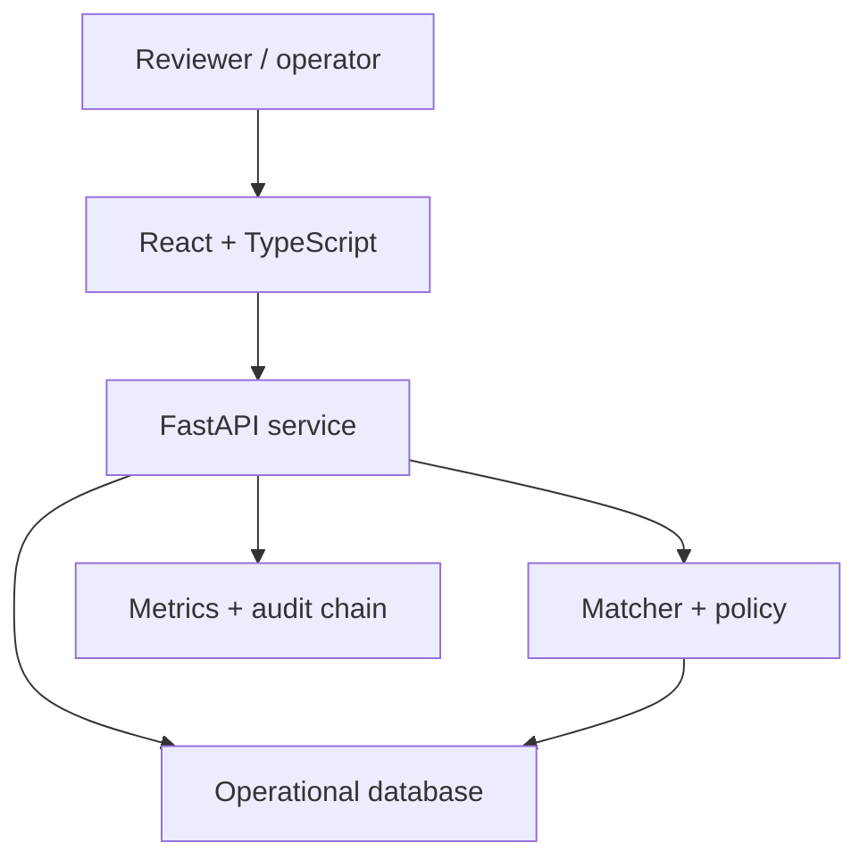

# CatalogOps

**Auditable product matching for marketplace catalogs.** CatalogOps turns a messy seller offer into one of three operational outcomes: automatically link it to a canonical product, send it to a human reviewer, or reject it as having no safe match. Every review and model-operations action is attributable and recorded in a tamper-evident audit chain.

CatalogOps is a portfolio-grade reference implementation, not a hosted production service. The repository currently demonstrates the complete local workflow on a small, inspectable dataset. The importer supports the public WDC Products benchmark, but full-corpus WDC results are deliberately marked **TBD** until they are produced by the published evaluation command on declared hardware.

## Run the local demo

Prerequisites: Docker with Compose v2.

```bash
make up
```

This wraps `docker compose up --build --wait`. Use that Compose command directly if `make` is unavailable.

Then open:

- Web application: <http://localhost:8080>
- Interactive API documentation: <http://localhost:8000/docs>
- API health check: <http://localhost:8000/health>

The sample data is intentionally small enough to inspect by hand. It is evidence that the workflow is wired together, not a substitute for a benchmark result.

The checked-in smoke artifact evaluates 19 held-out fixture listings: precision `1.000`, recall `0.923`, F1 `0.960`, and Recall@5 `1.000`. One correct but underspecified listing is intentionally routed to review. See [benchmark-results.md](docs/benchmark-results.md) for definitions, hashes, calibration/latency caveats, and the still-unfilled WDC table.

## What the demo proves

| Workflow | Evidence in this repository |
| --- | --- |
| Product matching | A reproducible lexical matcher scores an offer against canonical products and exposes match evidence. |
| Decision policy | Configurable thresholds map confidence to `auto_match`, `review`, or `no_match`. |
| Human review | Reviewers can resolve ambiguous candidates as matched, no match, duplicate, or needing more information. |
| Operational diagnosis | A deterministic investigator assembles incident evidence and proposes one bounded action. |
| Controlled execution | Proposed actions require approval and must belong to an explicit allowlist. |
| Auditability | State changes append actor, action, payload, timestamp, and hash-link metadata to an audit chain that can be verified. |
| Evaluation | Smoke evaluation is separated from the pending full WDC benchmark in [benchmark results](docs/benchmark-results.md). |

The default demo policy is:

```text
confidence >= 0.85              -> auto_match, if ambiguity guard passes
0.55 <= confidence < 0.85       -> review
confidence < 0.55               -> no_match
```

The matcher also requires a `0.06` lead over the runner-up for automatic matching unless an exact identifier agrees; otherwise a high-scoring ambiguous case stays in review. These are configurable **workflow thresholds**, chosen for demonstration. They are not presented as calibrated or WDC-optimal operating points.

## Product workflow

1. An offer arrives through the API or sample import.
2. The matcher normalizes product text, retrieves candidate catalog entities, and returns scores plus evidence.
3. The policy applies the active thresholds.
4. Medium-confidence cases enter the review queue; a reviewer resolves them explicitly.
5. Monitoring summarizes matching and review behavior. An operator can open an incident when quality or data health deteriorates.
6. The deterministic demo investigator inspects structured incident context and proposes only `rollback_model`, `adjust_threshold`, or `create_review_batch`.
7. An authorized human approves or rejects the proposal. Execution is a separate action.
8. Mutations are appended to the tamper-evident audit log; the chain-verification endpoint checks its integrity.

## Architecture



The local demo favors clarity and reproducibility over distributed-system theatre. It does not require Kafka or Kubernetes. See [architecture.md](docs/architecture.md) for component boundaries, decision and incident state transitions, and the planned production path.

## API workflow at a glance

Most read-only endpoints are public in the local demo; audit access and state-changing review/operations endpoints use `X-Role`. `X-Actor` supplies an attributable actor name. Prediction may persist inference/review records as an inference client and therefore should be rate-limited and authenticated separately in production.

```bash
# Score a listing
curl -sS -X POST http://localhost:8000/api/v1/matches/predict \
  -H 'Content-Type: application/json' \
  -d '{"title":"Sony WH-1000XM5 Wireless Headphones Black","brand":"Sony"}'

# Resolve a review as a reviewer
curl -sS -X POST http://localhost:8000/api/v1/reviews/REVIEW_ID/resolve \
  -H 'Content-Type: application/json' \
  -H 'X-Role: reviewer' \
  -H 'X-Actor: portfolio-demo' \
  -d '{"resolution":"matched","resolved_product_id":"DEMO-1002"}'

# Verify the audit chain
curl -sS http://localhost:8000/api/v1/audit/verify \
  -H 'X-Role: operator' \
  -H 'X-Actor: portfolio-demo'
```

Use the generated OpenAPI page for the exact request schema. `X-Role` is **not authentication**; it is a visible local-demo seam intended to be replaced by verified identity claims at a trusted gateway. See [threat-model.md](docs/threat-model.md).

## Reproduce the evaluation

The checked-in sample supports a fast smoke run:

```bash
make evaluate
```

The equivalent evaluator invocation after installing/activating the Python 3.12 environment is:

```bash
python -m evaluation.run \
  --offers data/sample/offers.jsonl \
  --catalog data/sample/catalog.csv \
  --output evaluation/results/sample-baseline.json \
  --check-thresholds
```

For WDC Products, download a benchmark configuration from the official source, retain its split boundaries, and import the compressed JSON Lines directly:

```bash
python -m pipelines.prepare_wdc /path/to/train.json.gz \
  --split train \
  --catalog-output data/processed/catalog.csv \
  --offers-output data/processed/train.jsonl \
  --catalog-split train

python -m pipelines.prepare_wdc /path/to/test.json.gz \
  --split test \
  --catalog-output data/processed/test-catalog-unused.csv \
  --offers-output data/processed/test.jsonl \
  --catalog-split train

cat data/processed/train.jsonl data/processed/test.jsonl \
  > data/processed/offers.jsonl

python -m evaluation.run \
  --catalog data/processed/catalog.csv \
  --offers data/processed/offers.jsonl \
  --train-split train \
  --eval-split test \
  --output evaluation/results/wdc-full.json
```

The importer accepts CSV, JSON arrays, JSON Lines, and gzip-compressed variants and maps documented WDC multi-class offer/entity fields into the internal record shape. Prepare validation the same way before any tuning. Pairwise WDC rows have a separate loader because their binary `label` must never be treated as a cluster ID. Combining split-labeled offer files for the evaluator does not permit fitting or threshold selection on validation/test records. Data is downloaded only through the explicit optional download command, and WDC files are not committed to this repository. See [data-card.md](docs/data-card.md) for the exact boundary and current pairwise limitation.

Source: [WDC Products benchmark](https://webdatacommons.org/largescaleproductcorpus/wdc-products/) — 11,715 offers, 2,162 entities, and nine train/validation/test sets that can be combined into 27 benchmark variants.

## Repository map

```text
apps/
  api/                 FastAPI routes and operational workflows
  web/                 React review and monitoring interface
services/matcher/      normalization, scoring, evidence, decision policy
pipelines/             dataset import and preparation
evaluation/            repeatable metrics and result artifacts
tests/                 unit and integration tests
infra/terraform/       deployment reference, not a claim of a live stack
docs/
  architecture.md
  design-system.md
  data-card.md
  model-card.md
  threat-model.md
  benchmark-results.md
  runbook.md
  demo-script.md
docker-compose.yml     one-command local environment
dvc.yaml               optional reproducible train/evaluate stages
params.yaml            versioned sample pipeline and gate parameters
```

## Test and quality checks

```bash
make lint
make test
npm --prefix apps/web run typecheck
npm --prefix apps/web run build
```

The latest local QA run collected and passed 54 tests with 74.6% branch coverage across the API and matcher packages. Treat that as a point-in-time repository result; the CI workflow is the durable release gate.

For the optional DVC path:

```bash
make dvc-repro
make dvc-metrics
```

Serving and evaluation identities are deliberately distinct. Plain `make up` without a trained artifact serves `catalogops-lexical-v1` (TF-IDF retrieval when available plus deterministic evidence scoring). Run `make dvc-repro` before `make up` to create and mount `artifacts/baseline`; prediction responses then report `catalogops-tfidf-logreg-v1`. The `model_version` returned by each prediction is the serving source of truth.

Run the load-test target only after the API is healthy:

```bash
python scripts/load_test.py \
  --url http://localhost:8000/health \
  --requests 500 \
  --concurrency 20
```

The checked-in `evaluation/results/api-load-test.json` records one bounded local health-endpoint run: 500 requests, concurrency 20, 0% errors, 423.28 requests/second, and 103.57 ms p95. It validates the HTTP harness, not model-serving capacity; see [benchmark results](docs/benchmark-results.md) for the limits.

CI is intended to make evaluation regressions visible; it should not train on or tune against a held-out test split. Do not add a CI or coverage badge until its linked workflow publishes a real passing result.

## Agent boundaries

The investigator is not a general-purpose chatbot and cannot make arbitrary API or shell calls. The current implementation is deterministic: it receives structured incident data and model metadata, assembles evidence, returns one allowlisted proposal, and stops. This makes the control plane testable without pretending that an LLM diagnosis exists. A future model-assisted investigator must preserve the same schema and treat its output as untrusted. Approval and execution are separate endpoints with role checks. The executor validates the proposal again before mutation.

The demo can illustrate rollback control flow and audit behavior; it does not claim a full external model registry deployment. A production rollback must also verify artifact signatures, compatibility, migration safety, and deployment health.

## Honest limitations

- The checked-in evaluation is a smoke test on a tiny sample. It cannot establish marketplace-level generalization.
- Full WDC precision, recall, F1, Recall@K, MRR, calibration, latency, and cost results are **TBD**.
- The current matcher is a reproducible baseline. Semantic retrieval, `pgvector`, cross-encoder reranking, and learned calibration belong to the measured next phase unless a result artifact explicitly says otherwise.
- Local `X-Role` headers demonstrate authorization policy but do not authenticate a caller.
- The audit chain is tamper-evident at the application layer. A database administrator can still delete or rewrite data; production needs restricted storage plus external anchoring or signed checkpoints.
- Local metrics and seeded incidents demonstrate observability workflows, not long-term drift detection on live traffic.
- The current investigator is a deterministic diagnostic workflow, not a deployed AI model. It proves agent boundaries and approval mechanics; model-assisted diagnosis remains future work.
- Redis and `pgvector` are available in the Compose topology, but the synchronous baseline path does not yet claim a Redis worker or vector-search implementation.
- DVC tracks the sample train/evaluate stages; MLflow and a remote model registry are not implemented.
- Terraform describes private ECS/Fargate services, RDS PostgreSQL, TLS ALB/Route53, encrypted/versioned artifact storage, an object-locked audit bucket, ECR, and CloudWatch alarms. It is still an unapplied scaffold: no AWS resources, remote state, endpoint, or successful deployment are claimed.
- If the API is unavailable, the web app switches to a visibly labelled UI fixture. Decisions and audit rows made in that fallback mode are local interface demonstrations, not persisted or cryptographically verified backend events.
- No public demo URL, release screenshots, or 90-second video is claimed yet; the checked [demo script](docs/demo-script.md) is the recording plan.

## Roadmap

1. Publish a safe read-only demo plus tagged screenshots and a 90-second workflow/failure video.
2. Publish a frozen WDC configuration, dataset checksum, full metrics, hardware, latency, and cost assumptions.
3. Add bi-encoder retrieval and compare it with the lexical baseline under the same split.
4. Add cross-encoder reranking and probability calibration; choose thresholds from business costs on validation data.
5. Back the candidate index with PostgreSQL/`pgvector` and publish query/load tests.
6. Replace demo role headers with OIDC/JWT verification and persist signed audit checkpoints outside the primary database.
7. Integrate a real model registry and verify a canary rollback end to end.

## Documentation

- [Architecture](docs/architecture.md)
- [Design system](docs/design-system.md)
- [Data card](docs/data-card.md)
- [Model card](docs/model-card.md)
- [Threat model](docs/threat-model.md)
- [Benchmark results](docs/benchmark-results.md)
- [Operations runbook](docs/runbook.md)
- [90-second demo script](docs/demo-script.md)

No screenshots are checked in yet. The live local interface is the current source of truth; screenshots should be added only after they match a tagged release.
# catops
