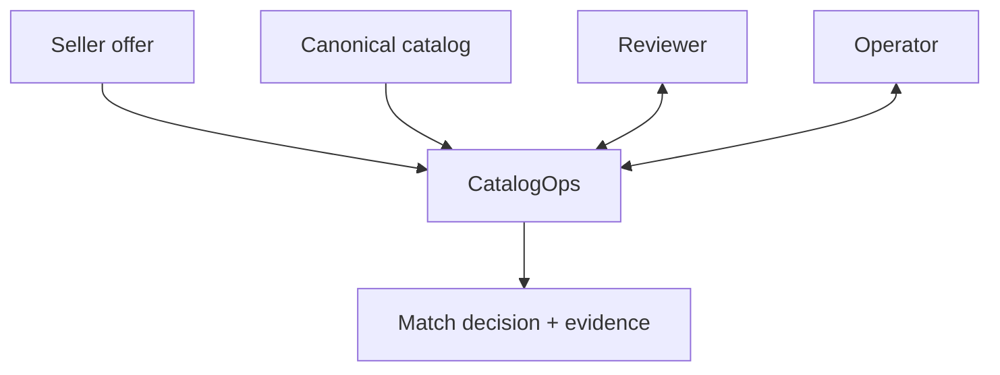
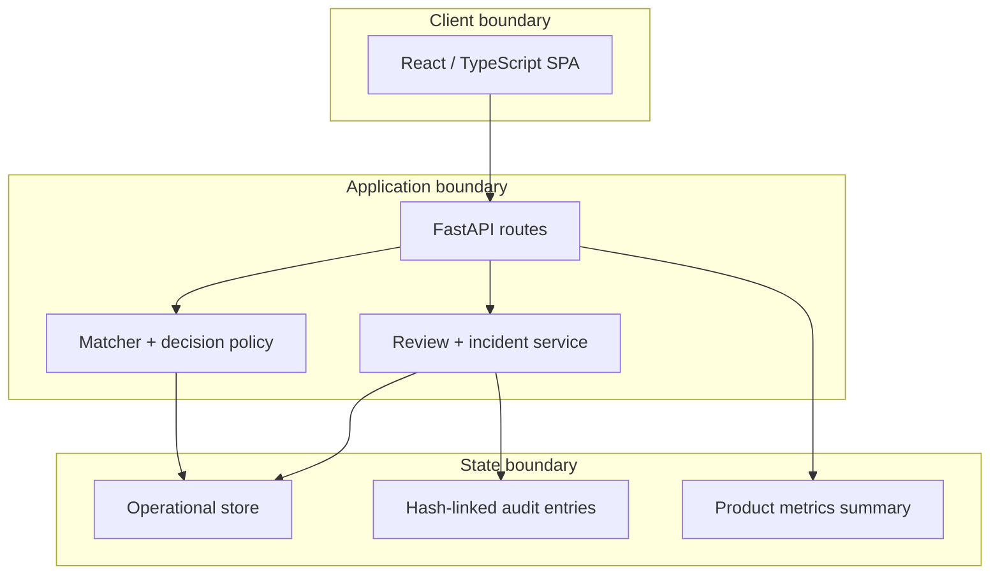
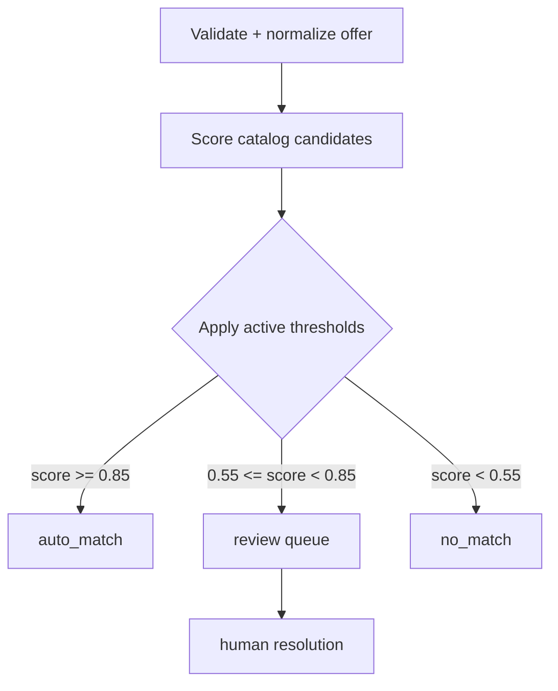
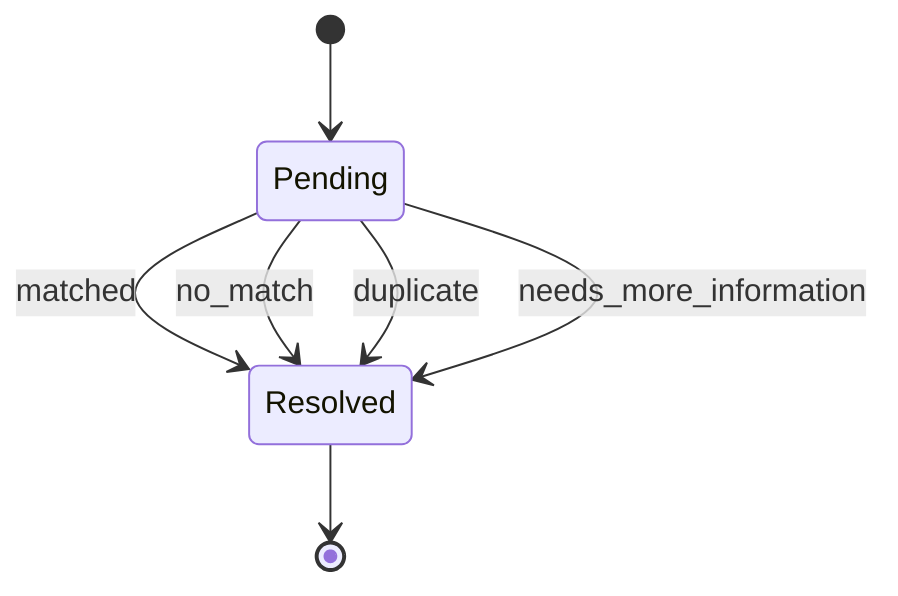
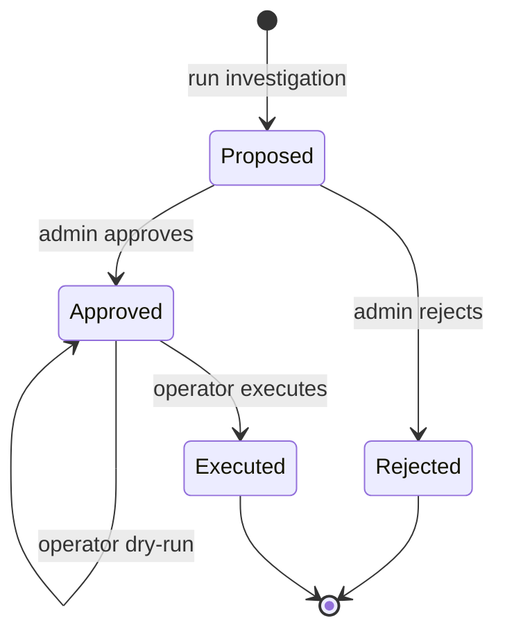
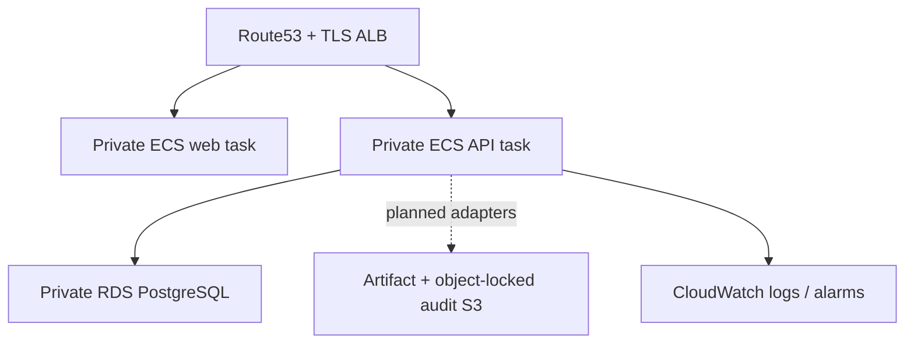

# Architecture

## Outcome and scope

CatalogOps makes product-identity decisions inspectable. It separates probabilistic model output from business policy, routes uncertainty to people, and ensures that operational changes cannot silently skip approval.

The implemented local architecture is deliberately small: a browser application, a FastAPI service, matcher code, an operational store, and metrics/audit surfaces. Semantic retrieval, a distributed task queue, a remote model registry, and an applied cloud deployment are evolution points, not prerequisites for demonstrating the core safety properties.

## System context

CatalogOps does not edit seller content or the canonical catalog as a side effect of prediction. It produces decisions and evidence. Explicit review or approved operational actions own later state changes.

## Components

| Component | Responsibility | Must not do |
| --- | --- | --- |
| Web app | Explain system state and collect explicit user intent | Infer approval from navigation or hide match evidence |
| API routes | Validate requests, enforce role policy, serialize responses | Trust an unverified role header in production |
| Matcher | Normalize, score candidates, and emit evidence | Change thresholds, approve itself, or mutate operational state |
| Decision policy | Map score to an operational route | Present demo thresholds as calibrated probabilities |
| Review service | Queue and resolve ambiguous cases | Re-score silently after a reviewer decision |
| Investigator | Deterministically assemble bounded incident context and propose an allowlisted action | Execute actions, run a shell, browse freely, or approve its own proposal |
| Executor | Revalidate approval and apply one supported action | Execute free-form model output |
| Audit chain | Make application mutations detectable and attributable | Guarantee immutability against a database administrator |

## Match lifecycle

The numeric defaults are a configurable demo policy. In a real marketplace they must be selected on validation data using the relative costs of false matches, missed matches, and review work. They should be versioned with model, dataset, and policy identifiers.

Each prediction should preserve at least:

- normalized input and identifiers;
- the model/version and policy/version;
- ranked candidate IDs and scores;
- field-level or token-level evidence available from the matcher;
- final route and active thresholds;
- timing and correlation metadata.

## Review state

Resolution is an intentional state change. The API requires the reviewer role, records the actor, and appends an audit entry. Production code should use idempotency keys or optimistic concurrency so two reviewers cannot silently overwrite one another.

## Incident, investigation, and execution

The associated incident moves from `open` to `investigating` when a proposal is created, then to `mitigating` after non-dry-run execution. Audit verification is a separate integrity check; it does not invent a `verified` investigation state or prove that the incident is resolved. The current API does not automatically close an incident after execution.

The current investigator is deterministic, not an LLM. It receives structured incident/failure metrics, queue state, current/previous model metadata, and a known-limitations evidence item. It can propose exactly one of:

- `rollback_model`
- `adjust_threshold`
- `create_review_batch`

An operator may also supply one schema-valid proposed action when starting the investigation. It passes the same allowlist and parameter validation; rollback targets must equal the registered previous stable model. It still cannot skip admin approval or separate execution. The audit record distinguishes who requested the proposal; the current demo does not claim that operator-supplied rationale was independently generated.

An operator runs an investigation; an admin approves or rejects it; an operator executes an approved proposal. Approval does not execute the action. The execution endpoint checks current state, required role, action schema, allowlist membership, and relevant bounds again. This split prevents an investigator response from becoming an implicit mutation. Proposal-hash binding, expiration, and full stale-state detection remain production hardening work.

### Rollback semantics

The local workflow records the requested model transition and demonstrates approval/audit behavior. A production registry adapter should additionally:

1. resolve an immutable, signed artifact identifier;
2. confirm feature/schema compatibility;
3. deploy to a canary or inactive slot;
4. run health and shadow checks;
5. shift traffic gradually;
6. preserve the replaced version for forward recovery;
7. append deployment evidence to an externally anchored audit checkpoint.

Until those adapters and checks exist, the repository should not claim production-grade artifact rollback.

## API surface

| Area | Endpoints | Local-demo access |
| --- | --- | --- |
| Health | `GET /health` | Public |
| Offers | `GET /api/v1/offers`, `POST /api/v1/offers` | Read public; create operator+ |
| Prediction | `POST /api/v1/matches/predict` | Public inference client; may persist when requested |
| Review | `GET /api/v1/reviews`, `POST /api/v1/reviews`, `POST /api/v1/reviews/{id}/resolve` | Read public; mutate reviewer+ |
| Metrics summary | `GET /api/v1/metrics/summary` | Public, explicitly demo-labelled |
| Incidents | `GET /api/v1/incidents`, `POST /api/v1/incidents` | Read public; create operator+ |
| Investigation | `POST /api/v1/investigations/run`, `GET /api/v1/investigations` | Read public; run operator+ |
| Approval | `POST /api/v1/investigations/{id}/approve`, `POST /api/v1/investigations/{id}/reject` | Admin only |
| Execution | `POST /api/v1/investigations/{id}/execute` | Operator+ after approval |
| Audit | `GET /api/v1/audit`, `GET /api/v1/audit/verify` | Operator+ |

The generated OpenAPI document is authoritative for payload schemas. The route inventory above is an architectural index, not a substitute for the schema.

## Persistence and integrity

The application keeps operational records (offers, predictions, reviews, incidents, investigations, and actions) separate from benchmark artifacts. Compose uses PostgreSQL with the `vector` extension available; the current baseline still performs in-process matching rather than claiming vector search. Redis is provisioned for the planned worker boundary but is not part of the synchronous matching/investigation path. Audit entries link to the previous entry hash. Verification recomputes the chain and reports the first inconsistency. SQLite and PostgreSQL initialization also install update/delete rejection triggers for audit rows, protecting against ordinary application/ORM mutation.

Hash chaining provides **tamper evidence**, subject to two important qualifications:

1. a sufficiently privileged administrator can disable the triggers, rewrite the entire database, and recompute every hash;
2. deletion of a suffix is not detectable without a trusted external checkpoint.

SQLite appends use a process-local lock and are intended only for the one-process demo. PostgreSQL appends also acquire a transaction-scoped advisory lock before reading the head, which serializes the chain across API workers and instances that share the database. A production system should still add contention/retry tests or isolate appends behind a dedicated audit writer before making a high-availability guarantee.

A production design should restrict write identities, sign periodic roots, and anchor them in a separate account or append-only service.

## Deployment profiles

| Profile | Status | Purpose |
| --- | --- | --- |
| Local Compose | Implemented demo target | One-command web/API/database startup and repeatable reviewer workflow |
| CI | Repository automation | Lint, tests, web build, and evaluation regression checks |
| Terraform | Unapplied reference scaffold | Private ECS/Fargate web/API tasks, RDS PostgreSQL, TLS ALB/Route53, encrypted S3/ECR, object-locked audit storage, and CloudWatch alarms/dashboard |
| Managed production | Not implemented | Verified identity, managed secrets, artifact registry, durable queue, external audit anchoring, backup/restore, SLOs |

### AWS reference topology

The Terraform includes ECR repositories, encryption, networking, autoscaling, health checks, deployment circuit breakers, and a manually dispatched plan/apply workflow using GitHub OIDC. It has not been applied. The application also does not yet export audit checkpoints to the object-locked bucket or load model artifacts from S3; the buckets and IAM permissions are infrastructure seams, not end-to-end evidence.

Docker and Terraform binaries were unavailable in the authoring runtime. Compose was parsed as YAML, while container startup and `terraform validate` remain CI/environment verification items.

## Reproducibility boundary

`dvc.yaml` defines two optional local stages: train the sample baseline and evaluate it against versioned thresholds from `params.yaml`. DVC is not required for the Compose demo. `make dvc-repro` writes `artifacts/baseline`; Compose mounts that directory read-only and the API loads it when present. Without it, the API fits the bundled catalog in memory and reports `catalogops-lexical-v1`; with it, predictions report `catalogops-tfidf-logreg-v1`. The tracked pipeline improves artifact/parameter traceability, but a production registry still needs signed immutable artifacts, remote-store controls, lineage, promotion state, and deployment evidence.

## CI evidence

The checked workflow gates:

- Ruff linting and Python tests with a 70% coverage floor;
- the sample evaluation with minimum precision `0.75`, recall `0.55`, F1 `0.63`, and Recall@5 `0.90`;
- TypeScript type checking and the production web build;
- Terraform formatting and validation;
- API and web container builds after application gates pass.

The latest local run passed 54 tests at 74.6% branch coverage across the API and matcher packages. Cloud/container tools were unavailable in that local runtime, so their workflow definitions are repository evidence, while successful remote CI runs must be verified on the hosting platform before adding status badges.

## Observability

The implemented `/api/v1/metrics/summary` endpoint provides the product view: decision distribution, review/incident counts, seeded demo-quality indicators, and inference latency summaries from persisted predictions. A dedicated Prometheus `/metrics` exporter is not currently implemented; OpenTelemetry/Prometheus service telemetry remains roadmap work.

Long-term drift requires labeled outcomes and a comparison window. A seeded incident or short local run demonstrates the response workflow only; it is not evidence that live data drift was statistically detected.

## Evolution path

The intended sequence is evidence-led:

1. freeze and measure the lexical baseline;
2. add embedding retrieval and compare Recall@K/latency under the same split;
3. add a cross-encoder and measure incremental precision, latency, and cost;
4. calibrate scores, select business thresholds, and version policy;
5. adopt PostgreSQL/`pgvector` when corpus size and query evidence justify it;
6. introduce asynchronous workers only when synchronous latency or failure isolation requires them;
7. deploy through a registry-backed canary and prove rollback behavior.
