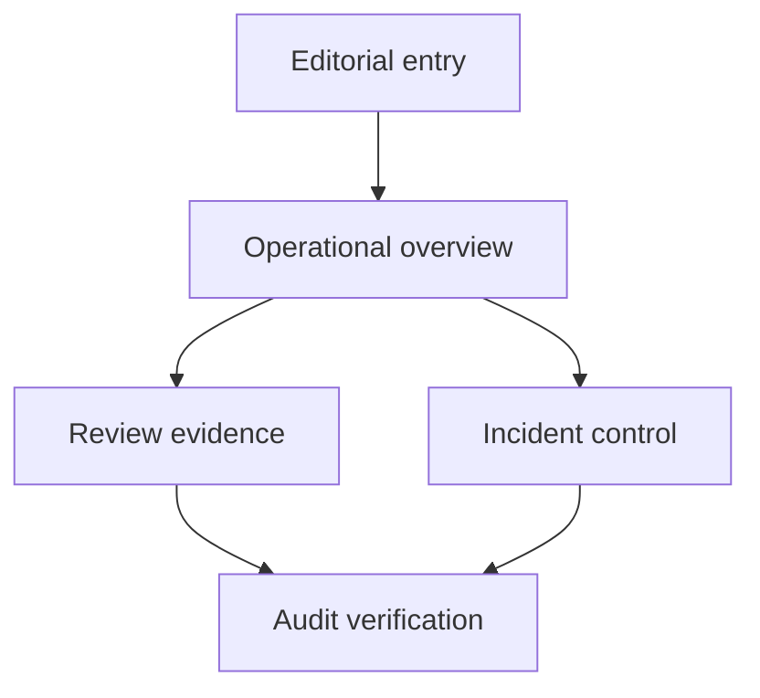

# CatalogOps design system

## Design thesis

CatalogOps should feel like **evidence moving through a controlled system**, not another generic SaaS dashboard.

The experience has two modes:

1. **Editorial entry:** a concise, cinematic explanation of the product-matching problem, uncertainty, and human control.
2. **Operations console:** a fast, low-motion workspace for reviewing evidence, responding to incidents, and verifying the audit trail.

The transition between them is intentional. Atmosphere earns attention once; clarity earns trust repeatedly.

## Product principles

### Evidence before decoration

Every strong visual treatment must help explain one of these relationships:

- messy offer to canonical candidate;
- score to decision threshold;
- incident signal to diagnosis;
- proposal to approval to execution;
- mutation to audit-chain evidence.

If an effect cannot make one of those relationships clearer, it does not belong in the product surface.

### Editorial composition, not a card grid

Avoid an interchangeable dashboard made from a heading followed by twelve equal rounded cards. Use hierarchy and composition:

- one dominant operational question per view;
- asymmetric editorial framing where it helps orientation;
- tables, timelines, split comparisons, and inline evidence for dense work;
- restrained panels only when they establish a real grouping or action boundary;
- whitespace that separates decisions, not whitespace added indiscriminately.

Cards are allowed when they behave as objects—a review case, incident, or hash-linked audit event—not as the default wrapper around every metric and sentence.

### Confidence is not certainty

Never use celebratory green, alarming red, or a dramatic animation to imply that a model score is truth. Show the score, route, thresholds, model/policy version, and evidence together. Label uncalibrated outputs as `score`, not `probability`.

### Human control must be visible

Proposal, approval, and execution are visually distinct states. Buttons must describe the exact action. A prominent approval control cannot be confused with execution, and a completed action must show actor and audit reference.

## Experience architecture



### Editorial entry

The entry may use richer composition, large typography, depth, and a single guided transition. Its job is to answer in seconds:

1. What is the costly ambiguity?
2. What does CatalogOps decide?
3. Where does a person intervene?
4. How is the decision proved later?

A useful opening sequence is an intentionally messy listing moving through normalization, candidate comparison, an uncertainty band, and a human checkpoint. It should resolve into the real console rather than remain a separate marketing fantasy.

### Operations console

The console prioritizes scan speed, predictable placement, keyboard use, and low visual noise. Its core routes are:

| Route | Primary question | Preferred composition |
| --- | --- | --- |
| `/overview` | Is the system healthy, and where does attention belong? | Strong summary statement, decision distribution, queue/incident signals, recent operations |
| `/reviews` | Does this candidate have enough evidence to accept? | Queue/index plus a focused side-by-side evidence workspace |
| `/incidents` | What changed, what evidence supports it, and what action is proposed? | Incident timeline, version comparison, evidence, separated proposal/approval/execution controls |
| `/audit` | Who changed what, and does the chain verify? | Dense chronological ledger, filters, chain status, entry detail |

Do not repeat the same top-level metrics on every route. Persistent navigation and compact environment/model context are enough.

## Visual language

### Depth

Use depth as an information hierarchy:

- **background:** quiet atmospheric field or restrained gradient;
- **workspace:** crisp, readable operational plane;
- **focus:** selected offer, candidate, incident, or audit event;
- **action:** approval/execution boundary with unmistakable state.

Volumetric depth can appear in the editorial entry through soft light, layered type, subtle grain, or parallax. In the console, depth should come mostly from contrast, borders, overlap, and sticky context—not constant blur and shadows.

Glass effects must never reduce text contrast or make table boundaries ambiguous. Avoid stacking translucent surfaces.

### Color roles

Use semantic roles rather than arbitrary per-component colors:

| Role | Use |
| --- | --- |
| Canvas | Deep neutral background that supports sustained viewing |
| Surface | Operational work area and grouped evidence |
| Primary text | Titles, values, and decisive content |
| Secondary text | Metadata and explanation, still meeting contrast requirements |
| Signal accent | Selection, focus, current model/policy, and primary navigation |
| Review | Uncertain cases requiring human attention |
| Success | Confirmed healthy state or completed verified action—not merely a high score |
| Danger | Destructive, integrity-failure, or genuinely unsafe condition |

Status must never rely on color alone. Pair color with text, iconography, position, or pattern. Keep high-chroma accents rare enough that they preserve meaning.

### Typography

The type system should create editorial authority without sacrificing operational density:

- display face or expressive weight for the entry statement only;
- highly legible UI sans for navigation, controls, tables, and prose;
- tabular numerals for scores, thresholds, latency, counts, and hashes;
- monospace only for identifiers, payload excerpts, and chain hashes;
- short measure for explanations; left alignment for operational scanning.

Use size and spacing before adding weight or color. Avoid oversized dashboard numerals with no decision context.

Suggested hierarchy:

| Token | Intended use |
| --- | --- |
| `display` | One entry statement, responsive and clamped |
| `title` | Route or selected-object title |
| `section` | Major evidence/action group |
| `body` | Explanations and reviewer evidence |
| `label` | Field labels, table headers, state metadata |
| `code` | IDs, hashes, model names, exact thresholds |

### Shape and spacing

- Use a small radius scale; operational objects should not look like soft consumer-app bubbles.
- Reserve the largest radius for the editorial frame or a singular focused object.
- Use one spacing rhythm across pages; dense tables may use a compact variant.
- Use rules, alignment, and whitespace before containers.
- Keep control sizes generous enough for pointer/touch without inflating every row.

## Core interaction patterns

### Candidate evidence comparison

The review workspace should keep the source offer and selected candidate visible together. Highlight exact identifiers and meaningful token/field correspondence, while making conflicts—capacity, generation, pack count, region—at least as prominent as matches.

Required context:

- raw and normalized offer fields;
- selected candidate and alternative rank/score;
- model score and active threshold band;
- model/policy identifiers;
- conflict and supporting evidence;
- explicit matched, no-match, duplicate, and needs-more-information actions.

Never reduce review to a score gauge plus “accept.”

### Threshold visualization

A compact threshold rail can explain policy:

```text
no_match < 0.55 | review 0.55–0.85 | auto_match >= 0.85
```

The rendered implementation should be semantic HTML/CSS, show numeric boundaries, and remain comprehensible without color or animation. It is a policy explanation, not a calibrated risk meter.

### Incident control

Show diagnosis evidence before the proposed action. Make the state progression explicit:

```text
incident:      open -> investigating -> mitigating
investigation: proposed -> approved/rejected -> executed
integrity:     audit verification is a separate check
```

Approval and execution must not share one compound button. After approval, preserve approver, proposal identity, timestamp, and any expiry. Execution should show its exact bounded effect before confirmation.

### Audit ledger

The audit view is a ledger, not an activity-feed decoration. Favor a dense table/timeline with:

- sequence and timestamp;
- actor and role;
- action and target;
- correlation/proposal reference;
- current/previous hash affordance;
- verification state.

Long hashes may truncate visually but must be copyable and available in full detail. Verification failure overrides atmospheric styling and provides the first invalid entry plus a clear response path.

## Motion system

Motion explains continuity; it must not become ambient distraction.

### Editorial motion

Permitted when supported by device capability and user preference:

- a single scroll-linked or staged transition from messy offer to controlled decision;
- restrained parallax between type and atmospheric depth;
- subtle reveal of candidate/evidence layers;
- one volumetric light or particle field whose absence changes no meaning.

Avoid perpetual object drift, cursor-chasing decoration, scroll hijacking, and long timelines that delay access to the demo.

### Console motion

Use short, low-amplitude transitions for:

- selected-row focus;
- panel/detail continuity;
- queue removal or state update;
- proposal-to-approved state confirmation;
- audit verification result.

Data refresh should not repeatedly animate the whole page. Never animate numeric metrics in a way that hides the actual value or implies false precision.

### Reduced motion

`prefers-reduced-motion: reduce` must:

- remove parallax and camera-like depth changes;
- replace staged movement with immediate or opacity-only state changes;
- disable nonessential loops;
- preserve every piece of content and every control;
- avoid smooth scrolling forced by the application.

## Progressive enhancement

WebGL, GSAP, shaders, and scroll libraries are optional implementation tools—not design requirements.

The current overview progressively loads Lenis, GSAP/ScrollTrigger, and a small Three.js shader-particle scene after first paint. That enhancement is confined to the editorial route, loads in separate chunks, pauses its renderer offscreen, and releases its animation frames, observers, listeners, geometry, material, renderer, and WebGL context on unmount. It is skipped for reduced-motion, touch/coarse-pointer, narrow, data-saver, and low-core clients. The review, incident, and audit routes do not depend on it to render or operate.

The baseline experience must work with semantic HTML, CSS, and the existing application runtime. If an enhanced entry is added:

1. feature-detect the capability;
2. load it after critical content and route functionality;
3. keep it outside review/incident/audit interaction paths;
4. provide a visually intentional static fallback;
5. disable it for reduced motion, constrained devices, or sustained poor frame time;
6. ensure errors cannot block navigation or the API workflow.

High-frequency operations surfaces stay fast because reviewers may process hundreds of cases. A 3D scene that competes for GPU/CPU, memory, network, focus, or screen-reader structure is a product regression even if it looks impressive in a recording.

## Accessibility guardrails

Target WCAG 2.2 AA for the application workflow.

- Use semantic landmarks, headings, tables, buttons, forms, and dialogs.
- Preserve a logical heading and DOM order even when the composition is asymmetric.
- Support full keyboard navigation with visible focus and no traps.
- Move focus intentionally after route changes, dialog actions, and queue resolution.
- Name scores, status, evidence conflicts, icons, and controls accessibly.
- Announce consequential async state changes without repeatedly reading live metrics.
- Maintain at least 4.5:1 contrast for normal text and 3:1 for large text/UI boundaries.
- Do not encode state only with hue, blur, position, or motion.
- Keep zoom/reflow usable at 200% and at narrow viewports.
- Offer skip navigation and a direct path past any editorial animation.
- Test review, approval, execution, and audit verification with keyboard and a screen reader.

Canvas/WebGL content, if used, is decorative unless an equivalent structured DOM representation is present.

## Performance guardrails

Treat the console as an operational tool with an explicit budget:

| Budget | Target |
| --- | --- |
| Critical route JS | Keep small enough for responsive mid-range hardware; split editorial enhancements from console code |
| Console interaction | Feedback should begin within 100 ms for local UI state |
| Animation | Target 60 fps; disable/degrade after sustained frame misses |
| Data tables | Paginate or virtualize only when evidence shows it is needed; preserve accessibility |
| Fonts | Minimal weights/subsets, `font-display: swap`, no typography dependency that blocks use |
| Images/textures | Responsive formats and sizes; never block the matching/review workflow |
| WebGL | Lazy, disposable, and absent from critical operational routes |

Measure on a representative laptop and a constrained/mobile profile. Lighthouse is useful for regressions, but route interaction timing and long-task traces on the review console are more meaningful than a marketing-page score alone.

## Responsive behavior

- Preserve the selected offer/candidate relationship rather than shrinking two unreadable columns.
- On narrow screens, stack source and candidate with a persistent comparison switch and visible conflicts.
- Tables may become labeled rows or use controlled horizontal scrolling; do not hide critical columns without a detail path.
- Approval/execution controls remain near their evidence and cannot become sticky overlays that obscure content.
- The editorial entry should shorten on smaller/constrained devices, not become a miniature desktop spectacle.

## Content voice

Use precise, evidence-led language:

- “Score 0.72 — routed to review,” not “72% sure.”
- “No safe match,” not “Product does not exist.”
- “Proposal approved,” not “Fix applied,” until execution succeeds.
- “Audit chain verifies through entry 184,” not “Immutable forever.”
- “Seeded incident,” not “Model drift detected,” unless a real detector and window produced it.

Buttons should name exact actions: `Approve candidate`, `Reject match`, `Approve threshold change`, `Execute review batch`. Avoid vague labels such as `Continue`, `Confirm`, or `Fix it` for consequential changes.

## Anti-patterns

Do not ship:

- a generic equal-card dashboard with decorative statistics;
- neon “AI” gradients on every surface;
- glass panels stacked over animated backgrounds;
- a chatbot as the main incident interface;
- confidence donuts that imply calibrated certainty;
- auto-playing motion in review, incident, or audit routes;
- scroll hijacking or navigation gated by animation;
- fake live counters, fake customer logos, or unlabelled seeded metrics;
- approval and execution collapsed into one interaction;
- low-contrast metadata, tiny hashes, or hover-only evidence;
- WebGL/GSAP added solely to satisfy an aesthetic checklist.

## Review checklist

- [ ] The first screen explains messy listing -> controlled decision without generic AI copy
- [ ] Editorial depth degrades to a deliberate static layout
- [ ] Review evidence remains faster to scan than the visual treatment is to notice
- [ ] Every score appears with route/threshold/model context
- [ ] Conflicts are as visible as matching signals
- [ ] Proposal, approval, execution, and verification are distinct
- [ ] All consequential actions work with keyboard and visible focus
- [ ] Reduced-motion mode retains the complete workflow
- [ ] Color contrast and non-color status cues pass
- [ ] Console performance is tested without optional visual enhancements
- [ ] Demo/sample values are labelled honestly
- [ ] The UI does not imply stronger security, calibration, drift detection, or rollback than the backend provides
